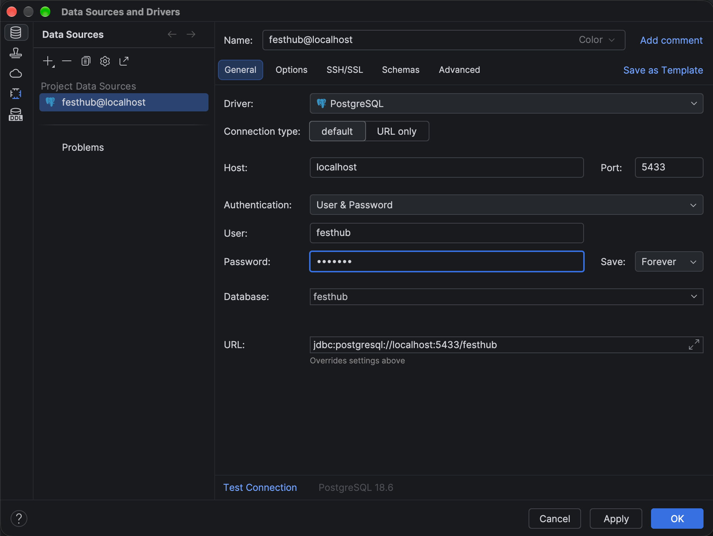

# FestHub

## first run

1. install latest [docker desktop](https://www.docker.com/products/docker-desktop/) and open it. 
2. clone the repo and go into it
   ```bash
   git clone https://github.com/csds383-AGT/layered.git
   cd layered
   ```
3. start everything
   ```bash
   docker compose up --build --watch
   ```
   the first run takes a few minutes: it builds the three images, generates the gRPC code from `festhub.proto` inside them, and creates the database from `db/schema.sql` and `db/seed.sql`. after that it starts in seconds
4. open http://localhost:5001
5. press ctrl+c to stop

nothing else needs installing on your machine, since python, the gRPC code and postgres all live in the containers.

## what's running

| container | inside docker | from your machine |
|---|---|---|
| web (flask site) | `172.30.83.10:5000` on `app_net` | http://localhost:5001 |
| logic (gRPC server) | `172.30.83.20:50051` on `app_net` | not reachable, it only accepts calls from web |
| db (postgres) | `db:5432` on `db_net` | `localhost:5433`, user, password and database all `festhub` |

## dev notes

while it's running, saved changes to `website.py`, `templates/`, `backend-server.py`, and `logic/` show up on their own, and changes to `festhub.proto` or `requirements.txt` rebuild the containers.

to reset the database to the demo data (needed whenever `db/schema.sql` or `db/seed.sql` changes):

```bash
docker compose down -v
```

if you want to access the postgres database  in your ide, use this config: 
